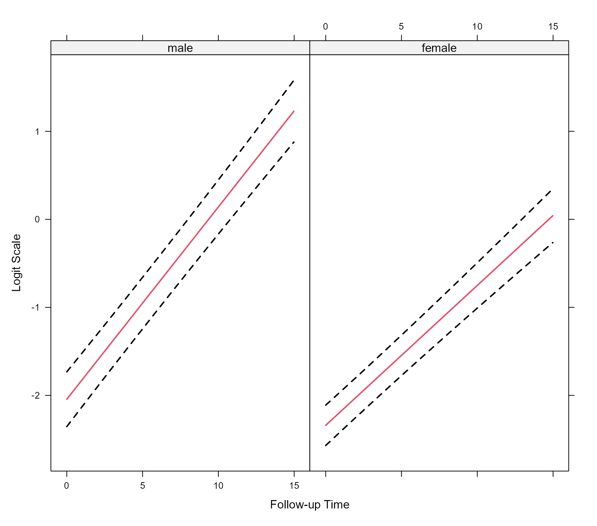
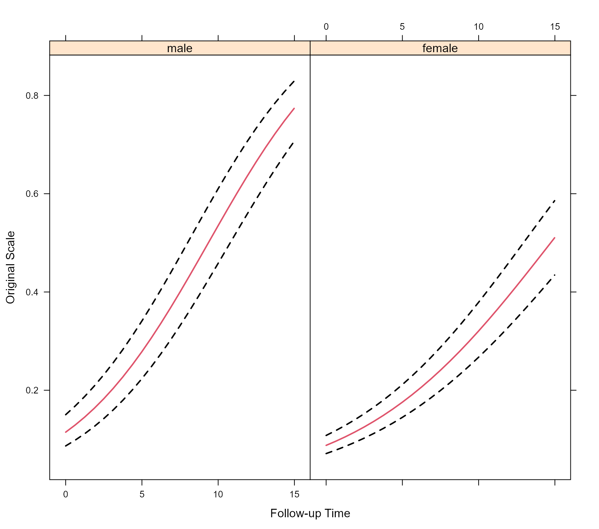

# Custom Models

## User-Defined Family Objects

In addition to the standard family objects in R, function
[`mixed_model()`](https://drizopoulos.github.io/GLMMadaptive/reference/mixed_model.md)
also allows for user-specified family objects to be given in its
`family` argument. The minimum requirements are that user-specified
family object is of class `"family"` and is a list with the following
components:

- `family`: a character string giving the name of the family.

- `link`: a character string giving the name of the link function.

- `linkfun`: a function that transforms the mean of the distribution of
  the outcome to the linear predictor scale.

- `linkinv`: a function that is the inverse of the `linkfun` defined
  above.

- `log_dens`: a function that returns the log of the probability density
  function or the log of the probability mass function of the
  distribution of the outcome given the random effects. This function
  should have exactly five arguments named, `y` the repeated
  measurements outcome, `eta` denoting the linear predictor (fixed +
  random effects), `mu_fun` the function to calculate the mean from the
  linear predictor (i.e., the `linkinv` function), `phis` a vector of
  possible extra dispersion/scale parameters, and `eta_zi` the linear
  predictor (fixed + random effects) for the logistic regression for the
  extra zeros; relevant in the cases of zero-inflated and two-part
  models. **Even if `phis` and `eta_zi` may not be required, it should
  always appear as arguments of `log_dens`**. Moreover, when the extra
  parameters `phis` are required, they should be appropriately
  transformed in order for the optimization of the log-likelihood to be
  unconstrained with regard to these parameters. Finally, `log_dens`
  should be fully vectorized with respect to `eta` and `eta_zi`. That
  is, for a numeric vector `y` and a numeric matrix `eta`, it should
  return a matrix with the log density evaluated at each column of
  `eta`, and likewise for `eta_zi`.

For the internal calculations the derivative of `log_dens` with respect
to the linear predictor `eta` and extra parameters `phis` (when present)
is also required. If it is not given, then it is approximated
numerically using a central difference approximation. However, it
greatly facilitates stability and speed if the user also specifies these
functions. If the user specifies these functions, they should have the
names `score_eta_fun` and `score_phis_fun`, respectively, and both of
them have three arguments named `y` the numeric vector of the repeated
measurements outcome, `mu` the numeric vector or matrix of the mean of
the outcome and `phis` a numeric vector of the extra parameters.

### Negative Binomial Mixed Effects Model

We first illustrate the use of a custom-made family object in the case
of a negative binomial repeated measurements outcome. We should note
however that a family object
[`negative.binomial()`](https://drizopoulos.github.io/GLMMadaptive/reference/negative_binomial.md)
is already defined in the package and users could invoke this instead -
for more info see the relative online help page for
[`negative.binomial()`](https://drizopoulos.github.io/GLMMadaptive/reference/negative_binomial.md).
We start by simulating some data:

``` r

set.seed(101)
dd <- expand.grid(f1 = factor(1:3), f2 = LETTERS[1:2], g = 1:30, rep = 1:15,
                  KEEP.OUT.ATTRS = FALSE)
mu <- 5*(-4 + with(dd, as.integer(f1) + 4 * as.numeric(f2)))
dd$y <- rnbinom(nrow(dd), mu = mu, size = 0.5)
```

Next we define a new family object for negative binomial data

``` r

my_negBinom <- function (link = "log") {
    stats <- make.link(link)
    log_dens <- function (y, eta, mu_fun, phis, eta_zi) {
        # the log density function
        phis <- exp(phis) # unconstrained optimization of 'phis'
        mu <- mu_fun(eta)
        log_mu_phis <- log(mu + phis)
        comp1 <- lgamma(y + phis) - lgamma(phis) - lgamma(y + 1)
        comp2 <- phis * log(phis) - phis * log_mu_phis
        comp3 <- y * log(mu) - y * log_mu_phis
        out <- comp1 + comp2 + comp3
        attr(out, "mu_y") <- mu
        out
    }
    structure(list(family = "user Neg Binom", link = stats$name, linkfun = stats$linkfun,
                   linkinv = stats$linkinv, log_dens = log_dens),
              class = "family")
}
```

And we fit the model

``` r

system.time(
    fm1 <-  mixed_model(fixed = y ~ f1 * f2, random = ~ 1 | g, data = dd, 
                        family = my_negBinom(), n_phis = 1, 
                        initial_values = list("betas" = poisson()))
)
#>    user  system elapsed 
#>    3.31    0.01    3.32

fm1
#> 
#> Call:
#> mixed_model(fixed = y ~ f1 * f2, random = ~1 | g, data = dd, 
#>     family = my_negBinom(), n_phis = 1, initial_values = list(betas = poisson()))
#> 
#> 
#> Model:
#>  family: user Neg Binom
#>  link: log 
#> 
#> Random effects covariance matrix:
#>                 StdDev
#> (Intercept) 0.07476986
#> 
#> Fixed effects:
#> (Intercept)         f12         f13         f2B     f12:f2B     f13:f2B 
#>   1.6361833   0.6031425   1.0137677   1.5385349  -0.4378977  -0.5835306 
#> 
#> phi parameters:
#>  -0.6477285 
#> 
#> log-Lik: -9994.062
```

In the call to
[`mixed_model()`](https://drizopoulos.github.io/GLMMadaptive/reference/mixed_model.md)
we specify the argument `n_phis` which lets the function know how many
extra parameters does the distribution of the outcome have. In addition,
we also specify that better quality initial values for the fixed effects
`betas` can be obtained by fitting a Poisson regression model to the
repeated measurements outcome (ignoring the correlations) with the same
design matrix as the fixed-effects design matrix. For the unique
elements of the random effects covariance matrix and for the extra
parameters `phis` the default initial values are used.

In the output, the reported phi parameters is on the log scale, because
in the definition of `log_dens` we specified that `phis <- exp(phis)`.

As mentioned above, the internal computations are facilitated if the
user also specifies the derivatives of the log density with respect to
the linear predictor `eta` and the extra parameters `phis`. Hence, in
the following we define a new negative binomial family object with these
functions also defined:

``` r

my_negBinom2 <- function () {
    stats <- make.link(link = "log")
    log_dens <- function (y, eta, mu_fun, phis, eta_zi) {
        # the log density function
        phis <- exp(phis)
        mu <- mu_fun(eta)
        log_mu_phis <- log(mu + phis)
        comp1 <- lgamma(y + phis) - lgamma(phis) - lgamma(y + 1)
        comp2 <- phis * log(phis) - phis * log_mu_phis
        comp3 <- y * log(mu) - y * log_mu_phis
        out <- comp1 + comp2 + comp3
        attr(out, "mu_y") <- mu
        out
    }
    score_eta_fun <- function (y, mu, phis, eta_zi) {
        # the derivative of the log density w.r.t. mu
        phis <- exp(phis)
        mu_phis <- mu + phis
        comp2 <- - phis / mu_phis
        comp3 <- y / mu - y / mu_phis
        # the derivative of mu w.r.t. eta (this depends on the chosen link function)
        mu.eta <- mu
        (comp2 + comp3) * mu.eta
    }
    score_phis_fun <- function (y, mu, phis, eta_zi) {
        # the derivative of the log density w.r.t. phis
        phis <- exp(phis)
        mu_phis <- mu + phis
        comp1 <- digamma(y + phis) - digamma(phis)
        comp2 <- log(phis) + 1 - log(mu_phis) - phis / mu_phis
        comp3 <- - y / mu_phis
        (comp1 + comp2 + comp3) * phis
    }
    structure(list(family = "user Neg Binom", link = stats$name, linkfun = stats$linkfun,
                   linkinv = stats$linkinv, log_dens = log_dens,
                   score_eta_fun = score_eta_fun, score_phis_fun = score_phis_fun),
              class = "family")
}
```

And we fit the model

``` r

system.time(
    fm2 <-  mixed_model(fixed = y ~ f1 * f2, random = ~ 1 | g, data = dd, 
                        family = my_negBinom2(), n_phis = 1, 
                        initial_values = list("betas" = poisson()))
)
#>    user  system elapsed 
#>    1.30    0.00    1.28

fm2
#> 
#> Call:
#> mixed_model(fixed = y ~ f1 * f2, random = ~1 | g, data = dd, 
#>     family = my_negBinom2(), n_phis = 1, initial_values = list(betas = poisson()))
#> 
#> 
#> Model:
#>  family: user Neg Binom
#>  link: log 
#> 
#> Random effects covariance matrix:
#>                 StdDev
#> (Intercept) 0.07476987
#> 
#> Fixed effects:
#> (Intercept)         f12         f13         f2B     f12:f2B     f13:f2B 
#>   1.6361832   0.6031425   1.0137677   1.5385349  -0.4378977  -0.5835306 
#> 
#> phi parameters:
#>  -0.6477284 
#> 
#> log-Lik: -9994.062
```

We obtain almost identical results, but in half of the computing time in
this example. Depending on the size of the data set, the gain in
computing time when the derivatives for `eta` and `phis` are provided
can be much more substantial.

### Student’s t Mixed Effects Model

We further illustrate the use of custom-made family objects by fitting a
linear mixed model but with Student’s t distributed error terms. We
start by simulating some data

``` r

set.seed(1234)
n <- 100 # number of subjects
K <- 8 # number of measurements per subject
t_max <- 15 # maximum follow-up time

# we construct a data frame with the design: 
# everyone has a baseline measurement, and then measurements at random follow-up times
DF <- data.frame(id = rep(seq_len(n), each = K),
                 time = c(replicate(n, c(0, sort(runif(K - 1, 0, t_max))))),
                 sex = rep(gl(2, n/2, labels = c("male", "female")), each = K))

# design matrices for the fixed and random effects
X <- model.matrix(~ sex * time, data = DF)
Z <- model.matrix(~ time, data = DF)

betas <- c(20.1, -0.5, 0.24, -0.05) # fixed effects coefficients
sigma <- 1.2 # scale parameter for the Student's t errors
D11 <- 1.5 # variance of random intercepts
D22 <- 1.2 # variance of random slopes

# we simulate random effects
b <- cbind(rnorm(n, sd = sqrt(D11)), rnorm(n, sd = sqrt(D22)))
# linear predictor
eta_y <- as.vector(X %*% betas + rowSums(Z * b[DF$id, ]))
# we simulate Student's t longitudinal data
DF$y <- eta_y + sigma * rt(n * K, df = 4)
```

Following we define the custom-made family object for the Student’s t
distribution:

``` r

students.t <- function (df = stop("'df' must be specified"), link = "identity") {
    .df <- df
    env <- new.env(parent = .GlobalEnv)
    assign(".df", df, envir = env)
    stats <- make.link(link)
    log_dens <- function (y, eta, mu_fun, phis, eta_zi) {
        # the log density function
        sigma <- exp(phis)
        out <- dt(x = (y - eta) / sigma, df = .df, log = TRUE) - log(sigma)
        attr(out, "mu_y") <- eta
        out
    }
    score_eta_fun <- function (y, mu, phis, eta_zi) {
        # the derivative of the log density w.r.t. mu
        sigma2 <- exp(phis)^2
        y_mu <- y - mu
        (y_mu * (.df + 1) / (.df * sigma2)) / (1 + y_mu^2 / (.df * sigma2))
    }
    score_phis_fun <- function (y, mu, phis, eta_zi) {
        sigma <- exp(phis)
        y_mu2_df <- (y - mu)^2 / .df
        (.df + 1) * y_mu2_df * sigma^{-2} / (1 + y_mu2_df / sigma^2) - 1
    }
    environment(log_dens) <- environment(score_eta_fun) <- environment(score_phis_fun) <- env
    structure(list(family = "Student's-t", link = stats$name, linkfun = stats$linkfun,
                   linkinv = stats$linkinv, log_dens = log_dens, 
                   score_eta_fun = score_eta_fun, score_phis_fun = score_phis_fun),
              class = "family")
}
```

And we fit the model (results not shown)

``` r

fm <-  mixed_model(y ~ sex * time, random = ~ time | id, data = DF, 
                   family = students.t(4), n_phis = 1, 
                   initial_values = list("betas" = gaussian()))
```

As was the case also for the negative binomial model, the extra `phis`
parameter has been appropriately transformed to have an unconstrained
optimization of the likelihood. Hence, the estimated `sigma` parameter
is given by `exp(fm$phis)`.

### Beta Mixed-Effects Model

As a final illustration we show how a beta mixed effects model can be
fitted, i.e., applicable in case of bounded repeated measurements
outcomes. We start again by simulating some data:

``` r

set.seed(1234)
n <- 100 # number of subjects
K <- 8 # number of measurements per subject
t_max <- 15 # maximum follow-up time

# we construct a data frame with the design: 
# everyone has a baseline measurement, and then measurements at random follow-up times
DF <- data.frame(id = rep(seq_len(n), each = K),
                 time = c(replicate(n, c(0, sort(runif(K - 1, 0, t_max))))),
                 sex = rep(gl(2, n/2, labels = c("male", "female")), each = K))

# design matrices for the fixed and random effects
X <- model.matrix(~ sex * time, data = DF)

betas <- c(-2.2, -0.25, 0.24, -0.05) # fixed effects coefficients
phi <- 5 # precision parameter of the Beta distribution
D11 <- 0.9 # variance of random intercepts

# we simulate random effects
b <- rnorm(n, sd = sqrt(D11))
# linear predictor
eta_y <- as.vector(X %*% betas + b[DF$id])
# mean
mu <- plogis(eta_y)
# we simulate beta longitudinal data
DF$y <- rbeta(n * K, shape1 = mu * phi, shape2 = phi * (1 - mu))
# we transform to (0, 1)
DF$y <- (DF$y * (nrow(DF) - 1) + 0.5) / nrow(DF)
```

Next we define the custom-made family object as in the case of the
Student’s t distribution:

``` r

beta.fam <- function () {
    stats <- make.link("logit")
    log_dens <- function (y, eta, mu_fun, phis, eta_zi) {
        # the log density function
        phi <- exp(phis)
        mu <- mu_fun(eta)
        mu_phi <- mu * phi
        comp1 <- lgamma(phi) - lgamma(mu_phi)
        comp2 <- (mu_phi - 1) * log(y) - lgamma(phi - mu_phi)
        comp3 <- (phi - mu_phi - 1) * log(1 - y)
        out <- comp1 + comp2 + comp3
        attr(out, "mu_y") <- mu
        out
    }
    score_eta_fun <- function (y, mu, phis, eta_zi) {
        # the derivative of the log density w.r.t. mu
        phi <- exp(phis)
        mu_phi <- mu * phi
        comp1 <- - digamma(mu_phi) * phi
        comp2 <- phi * (log(y) + digamma(phi - mu_phi))
        comp3 <- - phi * log(1 - y)
        # the derivative of mu w.r.t. eta (this depends on the chosen link function)
        mu.eta <- mu - mu * mu
        (comp1 + comp2 + comp3) * mu.eta
    }
    score_phis_fun <- function (y, mu, phis, eta_zi) {
        phi <- exp(phis)
        mu_phi <- mu * phi
        mu1 <- 1 - mu
        comp1 <- digamma(phi) - digamma(mu_phi) * mu
        comp2 <- mu * log(y) - digamma(phi - mu_phi) * mu1
        comp3 <- log(1 - y) * mu1
        (comp1 + comp2 + comp3) * phi
    }
    structure(list(family = "beta", link = stats$name, linkfun = stats$linkfun,
                   linkinv = stats$linkinv, log_dens = log_dens, 
                   score_eta_fun = score_eta_fun, score_phis_fun = score_phis_fun),
              class = "family")
}
```

And we fit the model

``` r

gm <- mixed_model(y ~ sex * time, random = ~ 1 | id, data = DF,
                  family = beta.fam(), n_phis = 1)

gm
#> 
#> Call:
#> mixed_model(fixed = y ~ sex * time, random = ~1 | id, data = DF, 
#>     family = beta.fam(), n_phis = 1)
#> 
#> 
#> Model:
#>  family: beta
#>  link: logit 
#> 
#> Random effects covariance matrix:
#>                StdDev
#> (Intercept) 0.9143138
#> 
#> Fixed effects:
#>    (Intercept)      sexfemale           time sexfemale:time 
#>    -2.04379396    -0.29655232     0.21844820    -0.05949062 
#> 
#> phi parameters:
#>  1.69036 
#> 
#> log-Lik: 581.2972
```

To depict the results of the model we create an effects plot, showing
the longitudinal evolution of the average/median male and female. We
start by constructing the data frame that contains the values we want to
depict, and using it in the
[`effectPlotData()`](https://drizopoulos.github.io/GLMMadaptive/reference/effectPlotData.md)
function; just for illustration, sandwich/robust standard errors are
used in the calculation of the 95% pointwise confidence intervals:

``` r

nDF <- with(DF, expand.grid(time = seq(min(time), max(time), length = 25),
                            sex = levels(sex)))

plot_data <- effectPlotData(gm, nDF, sandwich = TRUE)
```

The figure is created with a call to
[`xyplot()`](https://rdrr.io/pkg/lattice/man/xyplot.html) from the
[**lattice**](https://cran.r-project.org/package=lattice) package:

``` r

library("lattice")
xyplot(pred + low + upp ~ time | sex, data = plot_data,
       type = "l", lty = c(1, 2, 2), col = c(2, 1, 1), lwd = 2,
       xlab = "Follow-up Time", ylab = "Logit Scale")

expit <- function (x) exp(x) / (1 + exp(x))
xyplot(expit(pred) + expit(low) + expit(upp) ~ time | sex, data = plot_data,
       type = "l", lty = c(1, 2, 2), col = c(2, 1, 1), lwd = 2,
       xlab = "Follow-up Time", ylab = "Original Scale")
```


