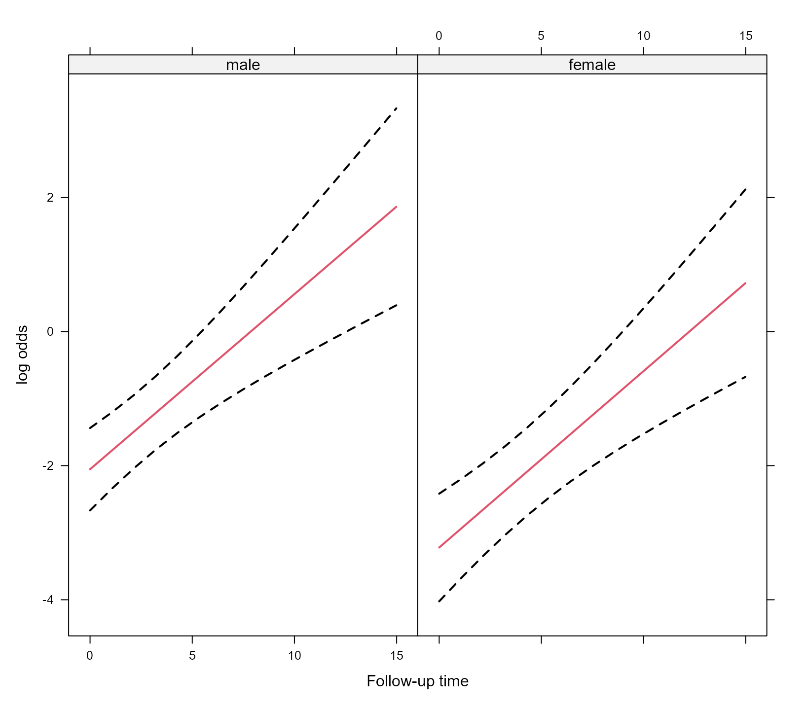
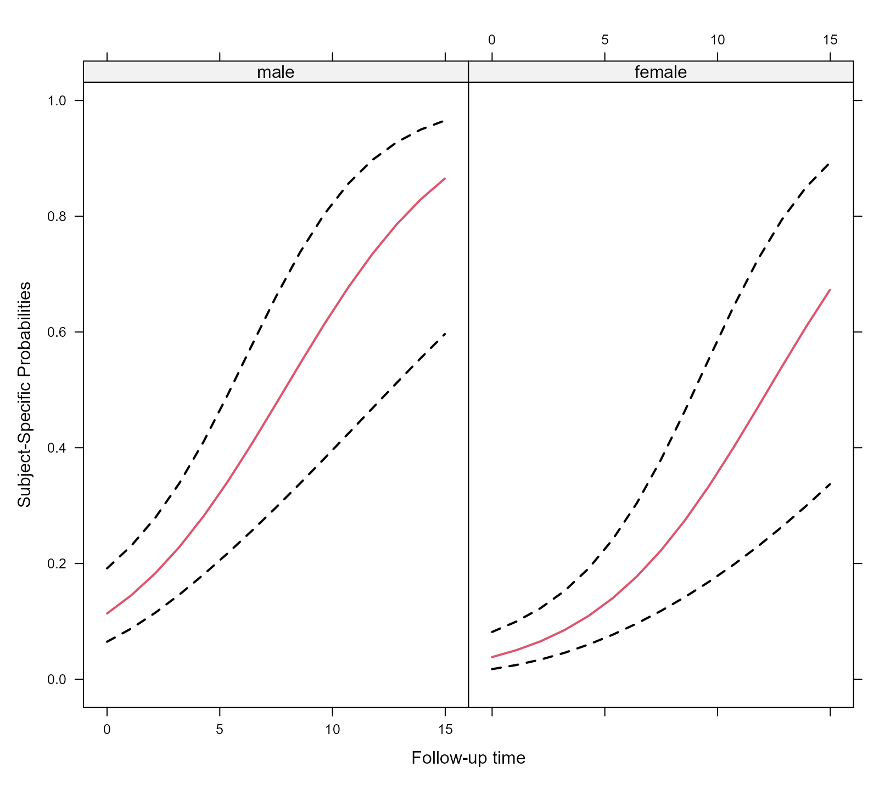
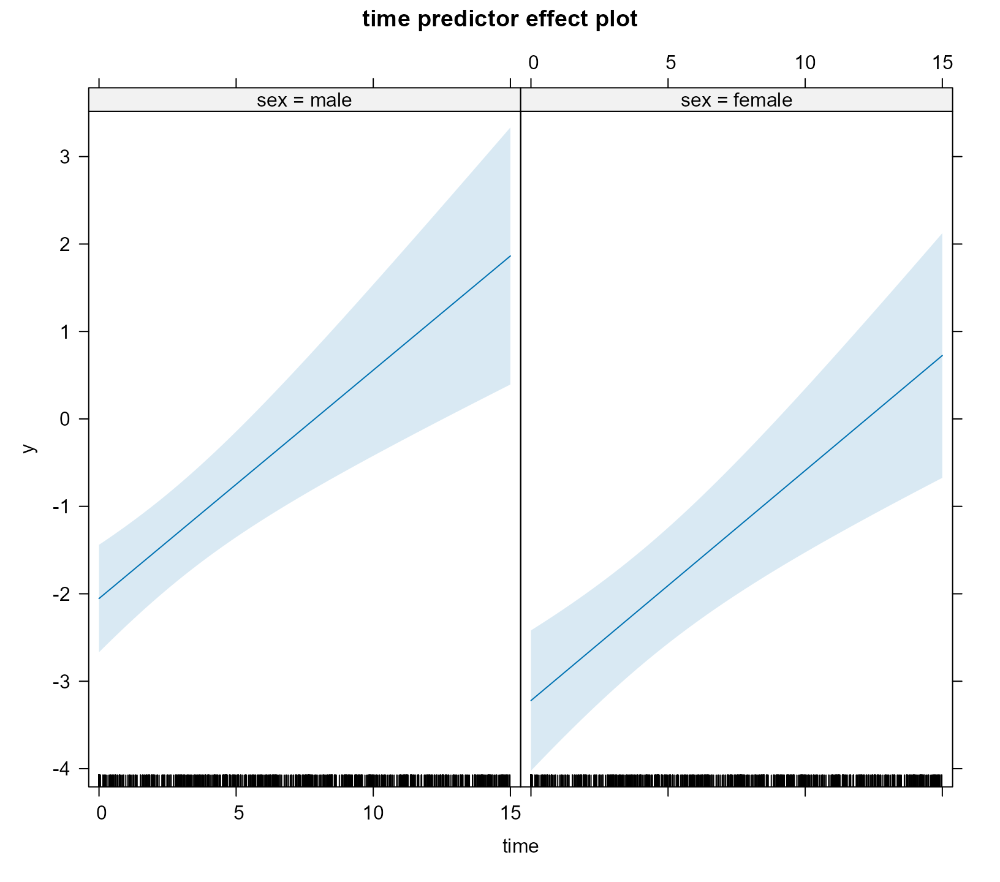
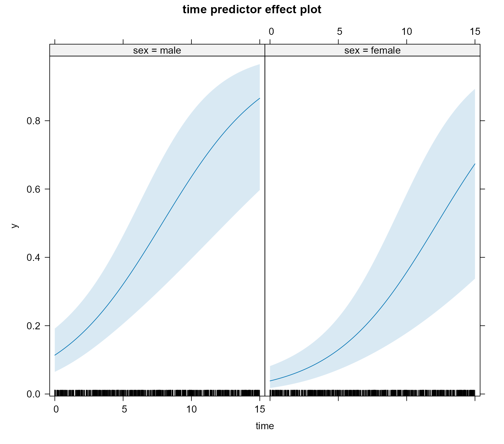

# Methods for MixMod Objects

## MixMod Objects

In this vignette we illustrate the use of a number of basic generic
functions for models fitted by the
[`mixed_model()`](https://drizopoulos.github.io/GLMMadaptive/reference/mixed_model.md)
function of package **GLMMadaptive**.

We start by simulating some data for a binary longitudinal outcome:

``` r

set.seed(1234)
n <- 100 # number of subjects
K <- 8 # number of measurements per subject
t_max <- 15 # maximum follow-up time

# we construct a data frame with the design: 
# everyone has a baseline measurement, and then measurements at random follow-up times
DF <- data.frame(id = rep(seq_len(n), each = K),
                 time = c(replicate(n, c(0, sort(runif(K - 1, 0, t_max))))),
                 sex = rep(gl(2, n/2, labels = c("male", "female")), each = K))

# design matrices for the fixed and random effects
X <- model.matrix(~ sex * time, data = DF)
Z <- model.matrix(~ time, data = DF)

betas <- c(-2.13, -0.25, 0.24, -0.05) # fixed effects coefficients
D11 <- 0.48 # variance of random intercepts
D22 <- 0.1 # variance of random slopes

# we simulate random effects
b <- cbind(rnorm(n, sd = sqrt(D11)), rnorm(n, sd = sqrt(D22)))
# linear predictor
eta_y <- as.vector(X %*% betas + rowSums(Z * b[DF$id, ]))
# we simulate binary longitudinal data
DF$y <- rbinom(n * K, 1, plogis(eta_y))
```

We continue by fitting the mixed effects logistic regression for `y`
assuming random intercepts and random slopes for the random-effects
part.

``` r

fm <- mixed_model(fixed = y ~ sex * time, random = ~ time | id, data = DF,
                  family = binomial())
```

### Detailed Output, Confidence Intervals, Covariance Matrix of the MLEs and Robust Standard Errors

As in the majority of model-fitting functions in R, the
[`print()`](https://rdrr.io/r/base/print.html) and
[`summary()`](https://rdrr.io/r/base/summary.html) methods display a
short and a detailed output of the fitted model, respectively. For
`'MixMod'` objects we obtain

``` r

fm
#> 
#> Call:
#> mixed_model(fixed = y ~ sex * time, random = ~time | id, data = DF, 
#>     family = binomial())
#> 
#> 
#> Model:
#>  family: binomial
#>  link: logit 
#> 
#> Random effects covariance matrix:
#>              StdDev    Corr
#> (Intercept)  0.6708        
#> time         0.2504  0.6771
#> 
#> Fixed effects:
#>    (Intercept)      sexfemale           time sexfemale:time 
#>   -2.054074559   -1.167171137    0.261179061    0.001919092 
#> 
#> log-Lik: -358.81
```

and

``` r

summary(fm)
#> 
#> Call:
#> mixed_model(fixed = y ~ sex * time, random = ~time | id, data = DF, 
#>     family = binomial())
#> 
#> Data Descriptives:
#> Number of Observations: 800
#> Number of Groups: 100 
#> 
#> Model:
#>  family: binomial
#>  link: logit 
#> 
#> Fit statistics:
#>  log.Lik      AIC      BIC
#>  -358.81 731.6201 749.8563
#> 
#> Random effects covariance matrix:
#>              StdDev    Corr
#> (Intercept)  0.6708        
#> time         0.2504  0.6771
#> 
#> Fixed effects:
#>                Estimate Std.Err z-value  p-value
#> (Intercept)     -2.0541  0.3135 -6.5520  < 1e-04
#> sexfemale       -1.1672  0.4674 -2.4974 0.012511
#> time             0.2612  0.0562  4.6465  < 1e-04
#> sexfemale:time   0.0019  0.0782  0.0245 0.980420
#> 
#> Integration:
#> method: adaptive Gauss-Hermite quadrature rule
#> quadrature points: 11
#> 
#> Optimization:
#> method: hybrid EM and quasi-Newton
#> converged: TRUE
```

The output is rather self-explanatory. However, just note that the
fixed-effects coefficients are on the linear predictor scale, and hence
are the corresponding log-odds for the intercept and log-odds ratios for
the rest of the parameters. The
[`summary()`](https://rdrr.io/r/base/summary.html) only shows the
estimated coefficients, standard errors and p-values, but no confidence
intervals. These can be separately obtained using the
[`confint()`](https://drizopoulos.github.io/GLMMadaptive/reference/methods.md)
method, i.e.,

``` r

exp(confint(fm))
#>                     2.5 %  Estimate    97.5 %
#> (Intercept)    0.06935384 0.1282114 0.2370189
#> sexfemale      0.12453520 0.3112462 0.7778859
#> time           1.16300701 1.2984601 1.4496892
#> sexfemale:time 0.85955461 1.0019209 1.1678671
```

By default the confidence intervals are produced for the fixed effects.
Hence, taking the exp we obtain the confidence intervals for the
corresponding odds-ratios. In addition, by default, the level of the
confidence intervals is 95%. The following piece of code produces 90%
confidence intervals for the variances of the random intercepts and
slopes, and for their covariance:

``` r

confint(fm, parm = "var-cov", level = 0.90)
#>                         5 %   Estimate      95 %
#> var.(Intercept)  0.05215263 0.44993929 3.8817866
#> cov.(Int)_time  -0.03353180 0.11372675 0.9573754
#> var.time         0.02229091 0.06269608 1.8119106
```

The estimated variance-covariance matrix of the maximum likelihood
estimates of all parameters is returned using the
[`vcov()`](https://rdrr.io/r/stats/vcov.html) method, e.g.,

``` r

vcov(fm)
#>                 (Intercept)    sexfemale         time sexfemale:time
#> (Intercept)     0.098285621 -0.074503587 -0.008218346   0.0061214019
#> sexfemale      -0.074503587  0.218419160  0.005918561  -0.0175401420
#> time           -0.008218346  0.005918561  0.003159598  -0.0029625773
#> sexfemale:time  0.006121402 -0.017540142 -0.002962577   0.0061145083
#> D_11           -0.087144845 -0.019450101  0.008226988   0.0018330740
#> D_12            0.016319967  0.003816805 -0.001721455  -0.0004511995
#> D_22           -0.086179960 -0.019240860  0.010703908   0.0001640289
#>                        D_11          D_12          D_22
#> (Intercept)    -0.087144845  0.0163199670 -0.0861799603
#> sexfemale      -0.019450101  0.0038168047 -0.0192408598
#> time            0.008226988 -0.0017214549  0.0107039078
#> sexfemale:time  0.001833074 -0.0004511995  0.0001640289
#> D_11            0.429096635 -0.0995595673  0.5054490456
#> D_12           -0.099559567  0.0369959559 -0.2113288859
#> D_22            0.505449046 -0.2113288859  1.3608398402
```

The elements of this covariance matrix that correspond to the elements
of the covariance matrix of the random effects (i.e., the elements
`D_xx`) are on the log-Cholesky scale.

Robust standard errors using the sandwich estimator can be obtained by
setting the logical argument `sandwich` to `TRUE`, i.e.,

``` r

vcov(fm, sandwich = TRUE)
#>                 (Intercept)    sexfemale         time sexfemale:time
#> (Intercept)     0.099391659 -0.070397984 -0.005230662   0.0024371653
#> sexfemale      -0.070397984  0.213557112  0.003080479  -0.0183175940
#> time           -0.005230662  0.003080479  0.002907956  -0.0026757968
#> sexfemale:time  0.002437165 -0.018317594 -0.002675797   0.0061654881
#> D_11           -0.080725016 -0.015253138  0.006087276   0.0034784924
#> D_12            0.017285024 -0.005008515 -0.001433528  -0.0002377204
#> D_22           -0.081839887  0.032219650  0.005452142   0.0024744855
#>                        D_11          D_12         D_22
#> (Intercept)    -0.080725016  0.0172850244 -0.081839887
#> sexfemale      -0.015253138 -0.0050085145  0.032219650
#> time            0.006087276 -0.0014335279  0.005452142
#> sexfemale:time  0.003478492 -0.0002377204  0.002474485
#> D_11            0.257361057 -0.0548096580  0.236161508
#> D_12           -0.054809658  0.0218015494 -0.122454801
#> D_22            0.236161508 -0.1224548013  0.831648499
```

The use of robust standard errors via the `sandwich` argument is also
available in the [`summary()`](https://rdrr.io/r/base/summary.html),
[`confint()`](https://drizopoulos.github.io/GLMMadaptive/reference/methods.md),
[`anova()`](https://drizopoulos.github.io/GLMMadaptive/reference/methods.md),
[`marginal_coefs()`](https://drizopoulos.github.io/GLMMadaptive/reference/marginal_coefs.md),
[`effectPlotData()`](https://drizopoulos.github.io/GLMMadaptive/reference/effectPlotData.md),
[`predict()`](https://drizopoulos.github.io/GLMMadaptive/reference/methods.md),
and
[`simulate()`](https://drizopoulos.github.io/GLMMadaptive/reference/methods.md)
methods.

### Fixed and Random Effects Estimates

To extract the estimated fixed effects coefficients from a fitted mixed
model, we can use the
[`fixef()`](https://drizopoulos.github.io/GLMMadaptive/reference/methods.md)
method. Similarly, the empirical Bayes estimates of the random effects
are extracted using the
[`ranef()`](https://drizopoulos.github.io/GLMMadaptive/reference/methods.md)
method, and finally the
[`coef()`](https://drizopoulos.github.io/GLMMadaptive/reference/methods.md)
method returns the subject-specific coefficients, i.e., the sum of the
fixed and random effects coefficients:

``` r

fixef(fm)
#>    (Intercept)      sexfemale           time sexfemale:time 
#>   -2.054074559   -1.167171137    0.261179061    0.001919092
```

``` r

head(ranef(fm))
#>   (Intercept)         time
#> 1  -0.3668557 -0.123029705
#> 2   0.6656146  0.289316275
#> 3   0.4836901  0.215040948
#> 4  -0.1905419 -0.008731612
#> 5   0.2477151  0.160121945
#> 6  -0.3739759 -0.183628663
```

``` r

head(coef(fm))
#>   (Intercept) sexfemale      time sexfemale:time
#> 1   -2.420930 -1.167171 0.1381494    0.001919092
#> 2   -1.388460 -1.167171 0.5504953    0.001919092
#> 3   -1.570384 -1.167171 0.4762200    0.001919092
#> 4   -2.244616 -1.167171 0.2524474    0.001919092
#> 5   -1.806359 -1.167171 0.4213010    0.001919092
#> 6   -2.428050 -1.167171 0.0775504    0.001919092
```

### Marginalized Coefficients

The fixed effects estimates in mixed models with nonlinear link
functions have an interpretation conditional on the random effects.
However, often we wish to obtain parameters with a marginal / population
averaged interpretation, which leads many researchers to use generalized
estimating equations, and dealing with potential issues with missing
data. Nonetheless, recently [Hedeker et
al.](https://dx.doi.org/10.1111/biom.12707) have proposed a nice
solution to this problem. Their approach is implemented in function
[`marginal_coefs()`](https://drizopoulos.github.io/GLMMadaptive/reference/marginal_coefs.md).
For example, for model `fm` we obtain the marginalized coefficients
using:

``` r

marginal_coefs(fm)
#>    (Intercept)      sexfemale           time sexfemale:time 
#>        -1.6023        -1.0967         0.1766         0.0508
```

The function calculates the marginal log odds ratios in our case
(because we have a binary outcome) using a Monte Carlo procedure with
number of samples determined by the `M` argument.

Standard errors for the marginalized coefficients are obtained by
setting `std_errors = TRUE` in the call to
[`marginal_coefs()`](https://drizopoulos.github.io/GLMMadaptive/reference/marginal_coefs.md),
and require a double Monte Carlo procedure for which argument `K` comes
also into play. To speed up computations, the outer Monte Carlo
procedure is performed in parallel using package **parallel** and number
of cores specified in the `cores` argument (results not shown):

``` r

marginal_coefs(fm, std_errors = TRUE, cores = 5)
```

### Fitted Values and Residuals

The
[`fitted()`](https://drizopoulos.github.io/GLMMadaptive/reference/methods.md)
method extracts fitted values from the fitted mixed model. These are
always on the scale of the response variable. The `type` argument of
[`fitted()`](https://drizopoulos.github.io/GLMMadaptive/reference/methods.md)
specifies the type of fitted values computed. The default is
`type = "mean_subject"` which corresponds to the fitted values
calculated using only the fixed-effects part of the linear predictor;
hence, for the subject who has random effects values equal to 0, i.e.,
the “mean subject”:

``` r

head(fitted(fm))
#>         1         2         3         4         5         6 
#> 0.1136413 0.1174427 0.1667803 0.5824581 0.5948132 0.5958325
```

Setting `type = "subject_specific"` will calculate the fitted values
using both the fixed and random effects parts, where for the latter the
empirical Bayes estimates of the random effects are used:

``` r

head(fitted(fm, type = "subject_specific"))
#>          1          2          3          4          5          6 
#> 0.08159052 0.08307721 0.10107748 0.23896421 0.24390719 0.24432017
```

Finally, setting `type = "marginal"` will calculate the fitted values
based on the multiplication of the fixed-effects design matrix with the
marginalized coefficients described above (due to the required computing
time, these fitted values are not displayed):

``` r

head(fitted(fm, type = "marginal"))
```

The
[`residuals()`](https://drizopoulos.github.io/GLMMadaptive/reference/methods.md)
method simply calculates the residuals by subtracting the fitted values
from the observed repeated measurements outcome. Hence, this method also
has a `type` argument with exactly the same options as the
[`fitted()`](https://drizopoulos.github.io/GLMMadaptive/reference/methods.md)
method.

### Effect Plots

To display the estimated longitudinal evolution of the binary outcome we
can use an effect plot. This is simply predictions from the models with
the corresponding 95% pointwise confidence intervals.

As a first step we create a data frame the provides the setting based on
which the plot is to be produced; function
[`expand.grid()`](https://rdrr.io/r/base/expand.grid.html) is helpful in
this regard:

``` r

nDF <- with(DF, expand.grid(time = seq(min(time), max(time), length.out = 15),
                            sex = levels(sex)))
```

Next we use the
[`effectPlotData()`](https://drizopoulos.github.io/GLMMadaptive/reference/effectPlotData.md)
function that does the heavy lifting, i.e., calculates the predictions
and confidence intervals from a fitted mixed model for the data frame
provided above, i.e.,

``` r

plot_data <- effectPlotData(fm, nDF)
```

Then we can produce the plot using for example the
[`xyplot()`](https://rdrr.io/pkg/lattice/man/xyplot.html) function from
package **lattice**, e.g.,

``` r

library("lattice")
xyplot(pred + low + upp ~ time | sex, data = plot_data,
       type = "l", lty = c(1, 2, 2), col = c(2, 1, 1), lwd = 2,
       xlab = "Follow-up time", ylab = "log odds")

expit <- function (x) exp(x) / (1 + exp(x))
xyplot(expit(pred) + expit(low) + expit(upp) ~ time | sex, data = plot_data,
       type = "l", lty = c(1, 2, 2), col = c(2, 1, 1), lwd = 2,
       xlab = "Follow-up time", ylab = "Subject-Specific Probabilities")
```



The
[`effectPlotData()`](https://drizopoulos.github.io/GLMMadaptive/reference/effectPlotData.md)
function also allows to compute marginal predictions using the
marginalized coefficients described above. This is achieved by setting
`marginal = TRUE` in the respective call (results not shown):

``` r

plot_data_m <- effectPlotData(fm, nDF, marginal = TRUE, cores = 2)

# we put the two groups in the same panel
my.panel.bands <- function(x, y, upper, lower, fill, col, subscripts, ..., font, 
                           fontface) {
    upper <- upper[subscripts]
    lower <- lower[subscripts]
    panel.polygon(c(x, rev(x)), c(upper, rev(lower)), col = fill, border = FALSE, ...)
}

xyplot(expit(pred) ~ time, group = sex, data = plot_data_m, 
       upper = expit(plot_data_m$upp), low = expit(plot_data_m$low), 
       type = "l", col = c("blue", "red"), 
       fill = c("#0000FF80", "#FF000080"),
       panel = function (x, y, ...) {
           panel.superpose(x, y, panel.groups = my.panel.bands, ...)
           panel.xyplot(x, y, lwd = 2,  ...)
}, xlab = "Follow-up time", ylab = "Marginal Probabilities")
```


### Effect Plots using the effects package

In addition to using the
[`effectPlotData()`](https://drizopoulos.github.io/GLMMadaptive/reference/effectPlotData.md)
function, the same type of effect plots can be produced by the
[**effects**](https://cran.r-project.org/package=effects) package. For
example, based on the `fm` model we produce the effect plot for `time`
and for the two groups using the call to
[`predictorEffect()`](https://rdrr.io/pkg/effects/man/predictorEffects.html)
and its [`plot()`](https://rdrr.io/r/graphics/plot.default.html) method:

``` r

library("effects")
plot(predictorEffect("time", fm), type = "link")
```



The `type` argument controls the scale of the y-axis, namely,
`type = "link"` corresponds to the log-odds scale. If we would like to
obtain the figure in the probability scale, we should set
`type = "response"`, i.e.,

``` r

plot(predictorEffect("time", fm), type = "response")
```



For the additional functionality provided by the
[**effects**](https://cran.r-project.org/package=effects) package, check
the vignette:
[`vignette("predictor-effects-gallery", package = "effects")`](https://cran.rstudio.com/web/packages/effects/vignettes/predictor-effects-gallery.pdf).

**Note:** Effects plots via the **effects** package are currently only
supported for the [`binomial()`](https://rdrr.io/r/stats/family.html)
and [`poisson()`](https://rdrr.io/r/stats/family.html) families.

### Comparing Two Models

The
[`anova()`](https://drizopoulos.github.io/GLMMadaptive/reference/methods.md)
method can be used to compare two fitted mixed models using a likelihood
ratio test. For example, we test if we can test the null hypothesis that
the covariance between the random intercepts and slopes is equal to zero
using:

``` r

gm <- mixed_model(fixed = y ~ sex * time, random = ~ time || id, data = DF,
                  family = binomial())

anova(gm, fm)
#> 
#>       AIC    BIC log.Lik  LRT df p.value
#> gm 730.94 746.57 -359.47                
#> fm 731.62 749.86 -358.81 1.32  1  0.2499
```

### Predictions

Using the
[`predict()`](https://drizopoulos.github.io/GLMMadaptive/reference/methods.md)
method we can calculate predictions for new subjects. As an example, we
treat subject 1 from the `DF` dataset as a new patient (in the code
below we change his `id` variable):

``` r

pred_DF <- DF[DF$id == 1, ][1:4, ]
pred_DF$id <- paste0("N", as.character(pred_DF$id))
pred_DF
#>   id      time  sex y
#> 1 N1 0.0000000 male 0
#> 2 N1 0.1424363 male 0
#> 3 N1 1.7055512 male 0
#> 4 N1 9.1391210 male 0
```

We start by computing predictions based only on the fixed-effects part
of the model; because of the nonlinear link function, these predictions
are of subjects with random effects value equal to zero, which is not to
the average predictions:

``` r

predict(fm, newdata = pred_DF, type_pred = "response",
        type = "mean_subject", se.fit = TRUE)
#> $pred
#>         1         2         3         4 
#> 0.1136413 0.1174427 0.1667803 0.5824581 
#> 
#> $se.fit
#>         1         2         3         4 
#> 0.3135054 0.3098525 0.2818563 0.4604014
```

Population averaged predictions can be obtained by first calculating the
marginalized coefficients (using
[`marginal_coefs()`](https://drizopoulos.github.io/GLMMadaptive/reference/marginal_coefs.md))
and multiplying them with the fixed effects design matrix; this is
achieved using the option `type = "marginal"` (due to the required
computing time, predictions not shown):

``` r

predict(fm, newdata = pred_DF, type_pred = "response",
        type = "marginal", se.fit = FALSE)
```

Finally, we calculate subject-specific predictions; the standard errors
are calculated with a Monte Carlo scheme (for details check the online
help file):

``` r

predict(fm, newdata = pred_DF, type_pred = "response",
        type = "subject_specific", se.fit = TRUE)
#> $pred
#>          1          2          3          4 
#> 0.07937211 0.08042079 0.09278510 0.17717561 
#> 
#> $se.fit
#>          1          2          3          4 
#> 0.02798864 0.02812851 0.03183041 0.11414979 
#> 
#> $low
#>          1          2          3          4 
#> 0.04111169 0.04173768 0.04769038 0.04912075 
#> 
#> $upp
#>         1         2         3         4 
#> 0.1506499 0.1516466 0.1657786 0.4532033 
#> 
#> $success_rate
#> [1] 0.51
```

Suppose now that we want predictions at time points at which no
responses `y` have been recorded, e.g.,

``` r

future_Times <- pred_DF[1:3, c("id", "time", "sex")]
future_Times$time <- c(3, 4, 10)
future_Times
#>   id time  sex
#> 1 N1    3 male
#> 2 N1    4 male
#> 3 N1   10 male
```

Predictions at these time points can be calculated by provide this data
frame in the `newdata2` argument of
[`predict()`](https://drizopoulos.github.io/GLMMadaptive/reference/methods.md):

``` r

predict(fm, newdata = pred_DF, newdata2 = future_Times, type_pred = "response",
        type = "subject_specific", se.fit = TRUE)
#> $pred
#>          1          2          3          4 
#> 0.07937211 0.08042079 0.09278510 0.17717561 
#> 
#> $pred2
#>         1         2         3 
#> 0.1042891 0.1140223 0.1900967 
#> 
#> $se.fit
#>          1          2          3          4 
#> 0.02798864 0.02812851 0.03183041 0.11414979 
#> 
#> $se.fit2
#>          1          2          3 
#> 0.03854246 0.04623848 0.12831826 
#> 
#> $low
#>          1          2          3          4 
#> 0.04111169 0.04173768 0.04769038 0.04912075 
#> 
#> $upp
#>         1         2         3         4 
#> 0.1506499 0.1516466 0.1657786 0.4532033 
#> 
#> $low2
#>          1          2          3 
#> 0.05136475 0.05067667 0.04688635 
#> 
#> $upp2
#>         1         2         3 
#> 0.1987982 0.2260157 0.4974809
```

### Simulate

The
[`simulate()`](https://drizopoulos.github.io/GLMMadaptive/reference/methods.md)
method can be used to simulate response outcome data from a fitted mixed
model. For example, we simulate two realization of our dichotomous
outcome:

``` r

head(simulate(fm, nsim = 2, seed = 123), 10)
#>       [,1] [,2]
#>  [1,]    0    0
#>  [2,]    0    0
#>  [3,]    0    0
#>  [4,]    1    0
#>  [5,]    1    0
#>  [6,]    0    1
#>  [7,]    0    0
#>  [8,]    1    0
#>  [9,]    0    0
#> [10,]    1    0
```

By setting `acount_MLEs_var = TRUE` in the call to
[`simulate()`](https://drizopoulos.github.io/GLMMadaptive/reference/methods.md)
we also account for the variability in the maximum likelihood estimates
in the simulation of new responses. This is achieved by simulating each
time a new response vector using a realization for the parameters from a
multivariate normal distribution with mean the MLEs and covariance
matrix the covariance matrix of the MLEs:

``` r

head(simulate(fm, nsim = 2, seed = 123, acount_MLEs_var = TRUE), 10)
#>       [,1] [,2]
#>  [1,]    0    0
#>  [2,]    0    0
#>  [3,]    1    0
#>  [4,]    1    1
#>  [5,]    0    0
#>  [6,]    1    0
#>  [7,]    0    0
#>  [8,]    0    0
#>  [9,]    1    0
#> [10,]    1    0
```
